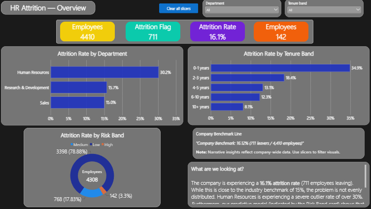
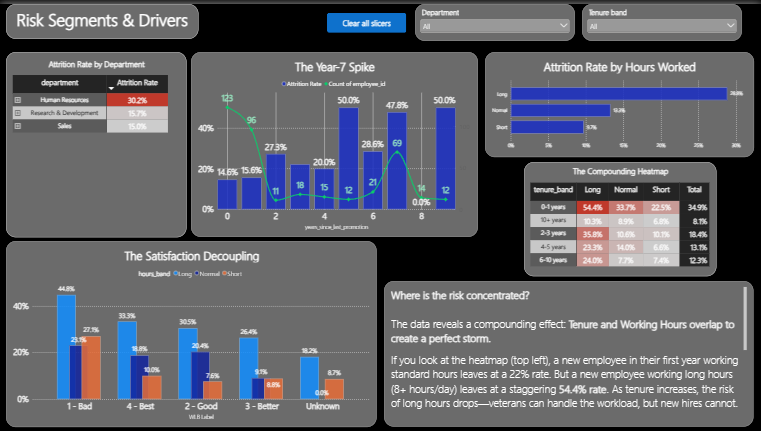

# HR Analytics — Employee Attrition Case Study

> A complete end-to-end data analyst portfolio project: from raw CSVs to a
> Power BI dashboard, with SQL analysis, Python validation, and a logistic
> regression model driving business recommendations.

---

## Overview

This project analyzes a synthetic HR dataset of **4,410 employees** to answer one question: **why do employees leave, and what can management do about it?**

The analysis follows a professional data analyst workflow — raw data → understanding → validation → database → SQL analysis → Python validation → statistical modeling → Power BI dashboard → business insights → documentation.

The result is not a report. It is a **decision tool**: a two-track recommendation backed by a calibrated predictive model, projected to avoid **~107 leavers per year** out of the 711 observed.

---

## Business Problem

The company is experiencing a **16.12% attrition rate** — 711 of 4,410 employees left. HR leadership has two problems:

1. **They don't know which employees are at risk** until the resignation letter arrives.
2. **They don't know which levers to pull.** Exit interviews are reactive and biased — they capture what people say, not what the data shows.

This project reframes attrition as a **predictable, addressable business problem** by identifying the drivers and quantifying the impact of interventions.

---

## Objectives

- **Diagnose** the drivers of attrition across tenure, hours, satisfaction, role, and department.
- **Validate** the findings across SQL and Python to ensure consistency.
- **Model** the combined effects of all drivers simultaneously using logistic regression.
- **Quantify** what-if interventions — how many leavers avoided per policy change.
- **Communicate** the findings in a Power BI dashboard for HR leadership and a written executive summary.

---

## Dataset

| Attribute | Value |
|-----------|-------|
| Employees | 4,410 |
| Leavers | 711 (16.12%) |
| Features | 28 after cleaning |
| Source | Synthetic HR dataset (portfolio use) |
| Files | `general_data.csv`, `employee_survey_data.csv`, `manager_survey_data.csv`, `in_time.csv`, `out_time.csv` |
| Attendance records | 1,041,930 daily in/out time rows, summarized to per-employee averages |

The dataset combines employee demographics, satisfaction surveys, manager ratings, and raw attendance swipes — merged into a single cleaned master table at `data/processed/hr_master_clean.csv`.

Full data documentation: [`docs/data_inventory.md`](docs/data_inventory.md), [`docs/data_quality_report.md`](docs/data_quality_report.md), [`docs/codebook.csv`](docs/codebook.csv).

---

## Tools

| Layer | Tool | Purpose |
|-------|------|---------|
| Data cleaning | Python (pandas) | Inspect, audit, merge raw files |
| Database | SQLite | Persist clean data, run analytical queries |
| Analysis | SQL (SQLite dialect) | 14 analytical queries, all in `sql/analysis/` |
| Validation | Python (pandas) | Cross-check SQL findings — 12/12 checks passed |
| Modeling | Python (statsmodels) | Logistic regression, what-if analysis |
| Visualization | Power BI | 3-page interactive dashboard |
| Documentation | Markdown | README, executive summary, data logs |

---

## Workflow

1. **RAW DATA → DATA UNDERSTANDING → DATA VALIDATION → DATABASE**
2. **SQL ANALYSIS → PYTHON VALIDATION → LOGISTIC REGRESSION**
3. **POWER BI DASHBOARD → BUSINESS INSIGHTS → DOCUMENTATION → GITHUB**

Each step is a real handoff with its own artifacts, logs, and validation report. Nothing is assumed — every finding in this README is reproducible from the raw files by running the pipeline end to end.

---

## SQL Analysis

All analytical queries live in [`sql/analysis/`](sql/analysis/) and run against the SQLite database `sql/hr_attrition.db`, populated from the cleaned master table via `sql/load_data.py`.

**14 queries** cover the full analytical arc — from baseline attrition rates to the high-risk cell findings that drive the recommendations:

| File | Question |
|------|----------|
| `01_attrition_overview.sql` | Baseline: 4,410 employees, 711 leavers, 16.12% |
| `02_attrition_by_department.sql` | HR (30.16%) vs R&D (15.71%) vs Sales (15.02%) |
| `03_attrition_by_job_role.sql` | Attrition by role |
| `04_attrition_by_tenure.sql` | 34.88% (0–1 yrs) → 8.13% (10+ yrs) |
| `05_attrition_by_income_band.sql` | Attrition by salary band |
| `06_satisfaction_vs_attrition.sql` | Satisfaction vs attrition |
| `07_attrition_by_worklife_overtime.sql` | Work-life balance & overtime |
| `08a_tenure_x_hours_overlap.sql` | **The 54.42% cell** (0–1 yrs × Long hours) |
| `08b_High_Risk_Segment_Profile.sql` | Profile of the high-risk segment |
| `08c_Promotion_Stagnation_Inside_High_Risk.sql` | Promotion stagnation inside the high-risk segment |
| `08c2_Year_7_Spike_Check.sql` | Year-7 attrition spike (47.8%, 69 employees) |
| `08d_High_Risk_Cells_Department.sql` | High-risk cells by department |
| `08d2_rd_year1_long_hours_role_breakdown.sql` | R&D × 0–1 yrs × Long hours (57.04%) |

Every query's output is saved to `sql/analysis/results/` as a CSV, so each finding is reproducible and auditable.

→ Full detail: [`sql/README.md`](sql/README.md)

---

## Python Analysis

Python serves **three roles** in this project: data preparation, SQL validation, and statistical modeling.

**Data preparation** — `python/analysis/01–04`:
- `01_inspect_raw_data.py` — inspect all five raw files
- `02_data_quality_audit.py` — audit nulls, duplicates, ranges
- `03_clean_master.py` — build `hr_master_clean.csv` (4,410 × 28)
- `04a_inspect_attendance.py` + `04_process_attendance.py` — summarize 1,041,930 attendance rows into per-employee averages

**SQL validation** — `python/analysis/05_validate_sql.py`:
- Re-runs every SQL finding in pandas
- **12/12 checks passed** — SQL and Python agree on every number
- Output: `python/outputs/validation_report.md`

**Statistical modeling** — `python/analysis/07_logistic_regression.py` + `08_model_impact.py`:
- Logistic regression on 4,308 employees (102 dropped via listwise deletion)
- Output: `python/outputs/logistic_regression_report.md`, `odds_ratios.csv`, `risk_scores.csv`
- What-if impact analysis: `python/outputs/what_if_impact.csv`

**EDA charts** — `python/analysis/06_eda_charts.py`:
- 8 charts saved to `python/outputs/charts/` (chart01–chart08)

→ Full detail: [`python/README.md`](python/README.md)

---

## Power BI Dashboard

A 3-page interactive dashboard in `powerbi/HR Analytics.pbix`, built on a flat table model merging all 4,410 employees with their risk scores and predicted probabilities via LEFT OUTER joins.

**Page 1 — Overview**
Company-wide attrition rate, headcount, department breakdown, and the key callout: **142 high-risk employees contain 84 leavers.**

**Page 2 — Segments**
The Year-1 Workload Shock (54.4%) and the Year-7 Career Cliff (47.8%) — with tenure × hours heatmap and sliceable segments.

**Page 3 — Action Plan**
The two-track recommendation with projected leavers avoided per intervention.

Slicers (Department, Tenure Band) are synced across all three pages.

→ Full detail: [`powerbi/README.md`](powerbi/README.md)

---

## Key Findings

**1. The Year-1 Workload Shock — the largest driver.**
Employees in their first year who work long hours leave at **54.42%** — more than **3× the company benchmark**. Within R&D specifically, this cell hits **57.04%** — the effect is role-uniform, not role-specific. Long hours are the strongest single driver in the model: employees working long hours are **2.5× more likely to leave**.

**2. Environmental Satisfaction — the broadest lever.**
Each level up in environmental satisfaction reduces risk of leaving by about **27%**. Job satisfaction (**~24%** per level) and work-life balance (**~22%** per level) follow the same pattern. Raising EnvSat one level is projected to avoid **~67 leavers** — the largest absolute impact of any intervention.

**3. The HR Department Anomaly — the diagnostic.**
HR employees leave at **30.16%** — roughly **twice** R&D (15.71%) and Sales (15.02%). The gap **holds even after accounting for tenure, hours, and satisfaction** — pointing to a department-specific issue that warrants focused investigation.

**Supporting observations:**
- **Year-7 Career Cliff:** 69 employees at Year 7 leave at **47.8%** — a volume-driven spike, not a rate anomaly. Reported as an observation; not explained by the model.
- **Risk model is calibrated:** 142 high-risk employees realize 59.15% actual attrition; 768 medium-risk realize 36.59%; 3,398 low-risk realize 9.77%. The model separates risk tiers cleanly.

---

## Business Insights

Attrition at this company is **not random**. Three drivers — first-year workload, satisfaction, and an HR-specific anomaly — account for most of it, and each is addressable with a different type of intervention:

- **Scheduling lever** (Track 1) — immediate, controllable, cheap
- **Cultural lever** (Track 2) — slow, broad, highest absolute payoff
- **Diagnostic lever** (HR) — investigative, targeted, no policy prescription until root cause is understood

The model converts HR from a **reactive, anecdote-driven function** into a **predictive, prioritized one** — with a ranked list of levers, not a list of complaints.

---

## Recommendations

**Track 1 — Immediate (90 days): Cap First-Year Hours.**
Capping hours at 7.5–8 hours/day for the **211 employees in their first year** projects to avoid **~40 leavers (~5.6% of observed)**. Policy change, not cultural — executable next quarter.

**Track 2 — Strategic (6–12 months): Improve Environmental Satisfaction.**
Raising EnvSat by one level for employees in the lowest satisfaction tiers projects to avoid **~67 leavers** — the highest absolute return of any single intervention.

**Diagnostic — HR Department Investigation.**
Bringing HR to parity with R&D/Sales represents roughly **~23 expected leavers avoided**. Warrants a focused investigation into HR hiring, role design, and management practices — not a blanket policy change.

**Combined impact: ~107 leavers avoided** — approximately **15% of the 711 observed**.

→ Full executive summary: [`docs/executive_summary.md`](docs/executive_summary.md)

---

## Limitations

- **Observational, not experimental.** The data shows strong associations — for example, long hours go with higher attrition — but does not prove causation. A hours-cap policy should be piloted and measured.
- **Synthetic dataset.** The data is a constructed portfolio dataset, not a live company's HR records. The methodology transfers; the exact percentages would not.
- **Year-7 anomaly remains unexplained.** Attrition spikes at Year 7 (47.8% for 69 employees), but the model does not identify a driver. Reported as an observation, not a conclusion.
- **Missing values were not imputed.** Blank satisfaction and survey fields were left blank. The model is fitted on the 4,308 employees with complete records, not all 4,410.

---

## Project Structure

| Directory / File | Description |
|------------------|-------------|
| `data/` | Cleaned master data, attendance summaries, and raw CSVs |
| `docs/` | Data logs, codebook, and executive summary |
| `outputs/charts/` | Reserved for final chart copies |
| `powerbi/HR Analytics.pbix` | Interactive 3-page dashboard |
| `powerbi/screenshots/` | Overview, Segments, Action Plan |
| `python/analysis/` | 9 scripts: prepare → validate → model |
| `python/outputs/` | Reports, CSVs, 8 EDA charts |
| `sql/` | Database, load scripts, and 14 analytical queries |

---

## Conclusion

This project demonstrates a **complete analyst workflow** — from raw data audit through database design, SQL analysis, cross-tool validation, statistical modeling, dashboard delivery, and executive communication.

The technical findings are strong, but the **real deliverable is the decision**: three concrete interventions, ranked by impact and feasibility, each with a quantified projection and a clear owner. That is what separates a data analyst from a data reporter — and it's the capability this project was built to demonstrate.

---

*Reproducible end-to-end from the raw CSVs. All queries, scripts, and model code are in this repository.*