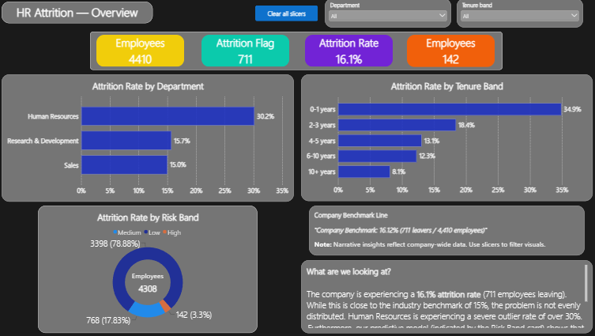
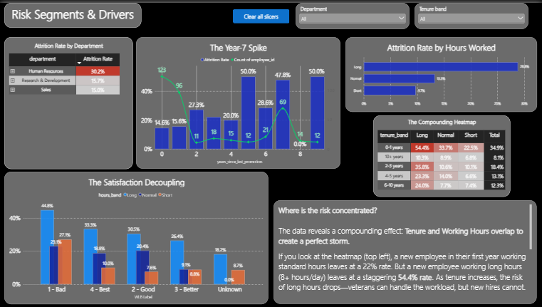

# Power BI Dashboard — 3 Pages

The interactive dashboard in `HR Analytics.pbix` presents the attrition analysis to HR leadership. Three pages, each answering a different question.

---

## Data Model

**Flat table model** — a single `employees` table at 4,410 rows, built by merging:
- `data/processed/hr_master_clean.csv` (28 columns)
- `python/outputs/risk_scores.csv` (`risk_band`, `predicted_prob`)

Merges use **LEFT OUTER joins** to preserve all 4,410 employees. The 102 blank `risk_band` values are correct — those employees were not scored by the model (listwise deletion).

**Connection:** CSV (Option B) — refresh by re-reading the CSVs after any Python re-run.

---

## Pages

### Page 1 — Overview

The executive summary in one screen.
- Company-wide KPI cards: 4,410 employees, 711 leavers, **16.12% attrition**
- Department breakdown: HR (30.16%) stands out
- **High-risk callout:** 142 high-risk employees contain **84 leavers**

---

### Page 2 — Segments

Where the risk concentrates.
- **Year-1 Workload Shock:** 0–1 yrs × Long hours = **54.4%** attrition
- **Year-7 Career Cliff:** 69 employees at Year 7, **47.8%** attrition — a volume spike, not a rate anomaly
- Tenure × hours heatmap
- Sliceable by Department and Tenure Band

---

### Page 3 — Action Plan

The recommendation, quantified.
- **Track 1 (Immediate):** Cap First-Year Hours → **~40 leavers avoided**
- **Track 2 (Strategic):** Improve Environmental Satisfaction → **~67 leavers avoided**
- **Diagnostic:** HR Department Investigation → **~23 leavers avoided**
- **Combined: ~107 leavers avoided (~15% of the 711 observed)**

---

## Features

- **Slicers synced across all three pages** — Department and Tenure Band. Change once, filter everywhere.
- **Measures:**
  - `Attrition Rate = DIVIDE(SUM('employees'[attrition_flag]), COUNTROWS('employees'))`
- **Calculated columns:**
  - `hours_band` — Short / Normal / Long (with an "Unknown" fallback)
  - `WLB Label` — 1–4 satisfaction labels
- **Design:** light-gray canvas, white visual borders, aligned layout, consistent typography across pages.

---

## Screenshots

All three pages captured at full size in `screenshots/`:

| File | Page |
|------|------|
| `Overview.png` | Page 1 — Overview |
| `Segments.png` | Page 2 — Segments |
| `Action Plan.png` | Page 3 — Action Plan |

The `.pbix` file itself is in this folder (`HR Analytics.pbix`) — open in Power BI Desktop to interact with the live dashboard.