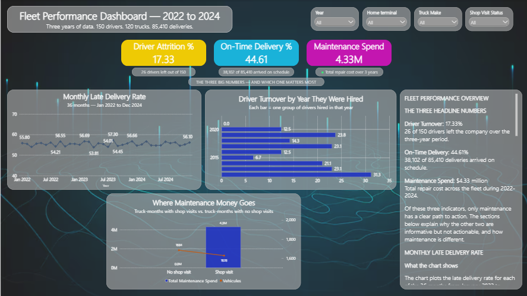
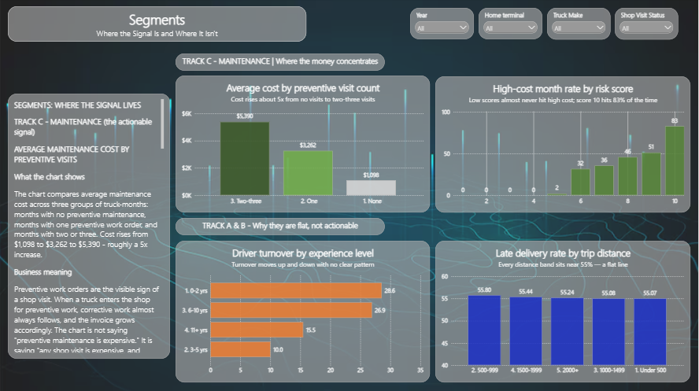

# Logistics Operations Database — Fleet Maintenance & Cost Savings

> A complete end-to-end data analyst portfolio project: from raw fleet CSVs to a
> 3-page Power BI dashboard, with SQL analysis, Python validation, and a logistic
> regression model driving actionable business recommendations.

---

## Overview

This project analyzes three years of fleet operations data to answer one question for a Logistics Supervisor: **where does the fleet actually lose money, and what should we do about it?**

The analysis follows a professional data analyst workflow — raw data → cleaning → database → SQL analysis → Python validation → statistical modeling → Power BI dashboard → business insights.

The result is not just a report. It is a **decision tool**: a maintenance strategy backed by a calibrated predictive model, projected to save **$950K–$1.27M annually** and protect an additional **$387K** from being spent in the wrong direction.

---

## Business Problem

The company manages a fleet of trucks with a total 3-year maintenance spend of **$4.33 million**. Leadership has two problems:

1. **They don't know which maintenance months are going to be expensive** until the invoices arrive.
2. **They don't know which levers to pull.** The intuitive solution — "do more preventive maintenance" — actually increases costs.

This project reframes fleet maintenance as a **predictable, addressable business problem** by identifying the true cost drivers and quantifying the impact of scope discipline and downtime reduction.

---

## Objectives

- **Diagnose** the drivers of high-cost maintenance months across vehicle age, make, miles, downtime, and preventive visits.
- **Test** two other analytical tracks (Driver Attrition and On-Time Delivery) to see if they contain actionable signals.
- **Model** the combined effects of all maintenance drivers simultaneously using logistic regression.
- **Quantify** what-if interventions — what happens if we add 10% more preventive visits? (Spoiler: Costs go up).
- **Communicate** the findings in a Power BI dashboard for the Logistics Supervisor and a written executive summary.

---

## Dataset

| Attribute | Value |
|-----------|-------|
| Source Tables | 16 raw CSVs |
| Analytical Masters | 3 clean tables (driver, trip, truck-month) |
| Maintenance Records | 3,312 truck-months |
| Total Spend Analyzed | $4.33 million |
| Source | Synthetic fleet operations dataset (portfolio use) |
| Files | `trips.csv`, `maintenance_records.csv`, `drivers.csv`, `truck_utilization_metrics.csv`, etc. |

The dataset combines driver demographics, trip logs, safety incidents, and raw maintenance invoices — merged into three cleaned master tables in `data/processed/`.

Full data documentation: [`docs/data_inventory.md`](docs/data_inventory.md), [`docs/data_quality_report.md`](docs/data_quality_report.md), [`docs/codebook.csv`](docs/codebook.csv).

---

## Tools

| Layer | Tool | Purpose |
|-------|------|---------|
| Data cleaning | Python (pandas) | Inspect, audit, merge 16 raw files |
| Database | SQLite | Persist clean data, run analytical queries |
| Analysis | SQL (SQLite dialect) | 28 analytical queries, all in `sql/analysis/` |
| Validation | Python (pandas) | Cross-check SQL findings |
| Modeling | Python (statsmodels) | Logistic regression, what-if analysis |
| Visualization | Power BI | 3-page interactive dashboard |
| Documentation | Markdown | README, executive summary, data logs |

---

## Workflow

1. **RAW DATA → DATA UNDERSTANDING → DATA VALIDATION → DATABASE**
2. **SQL ANALYSIS (28 Queries) → PYTHON VALIDATION → LOGISTIC REGRESSION**
3. **POWER BI DASHBOARD → BUSINESS INSIGHTS → DOCUMENTATION → GITHUB**

Each step is a real handoff with its own artifacts, logs, and validation report. Nothing is assumed — every finding in this README is reproducible from the raw files by running the pipeline end to end.

---

## SQL Analysis

All analytical queries live in [`sql/analysis/`](sql/analysis/) and run against the SQLite database `sql/db/logistics.db`, populated from the cleaned master tables via `sql/load_data.py`.

**28 queries** cover three independent analytical tracks:

| Track | Queries | Question |
|------|---------|----------|
| **Track A — Attrition** | 11 | Can we predict which drivers will leave? (Result: Flat across all segments) |
| **Track B — On-Time** | 10 | Which routes or customers cause late deliveries? (Result: Uniformly late at 54-57%) |
| **Track C — Maintenance** | 7 | What drives high-cost maintenance months? (Result: **Highly actionable**) |

Every query's output is saved to `sql/results/` as a CSV, so each finding is reproducible and auditable.

→ Full detail: [`sql/README.md`](sql/README.md)

---

## Python Analysis

Python serves **three roles** in this project: data preparation, SQL validation, and statistical modeling.

**Data preparation** — `python/analysis/01–02`:
- `01_inspect.py` — inspect all 16 raw files
- `02_clean_data.py` — build the 3 clean master CSVs

**SQL validation** — `python/analysis/06_validate_sql.py`:
- Re-runs SQL findings in pandas to ensure SQL and Python agree on every number.

**Statistical modeling** — `python/analysis/07_track_c_model.py`:
- Logistic regression on 3,312 truck-months
- Output: `python/outputs/07_model_report.txt`
- What-if impact analysis: Predicts that adding 10% more preventive visits increases cost by $387K.

→ Full detail: [`python/README.md`](python/README.md)

---

## Power BI Dashboard

A 3-page interactive dashboard in `powerbi/Logistics Operations.pbix`, built on the processed CSV files.

**Page 1 — Overview**
Total fleet spend, headline numbers, and the flat patterns in attrition and delivery.

**Page 2 — Segments**
The vivid contrast between Track C (Maintenance cost drivers) and Tracks A/B (Flat lines). 

**Page 3 — Action Plan**
The three quantified recommendations (scope control, downtime reduction, avoid blanket PM increases).

Slicers (Year, Terminal, Make, Shop Visits) are synced across all three pages.

→ Full detail: [`powerbi/README.md`](powerbi/README.md)

---

## Key Findings

**1. Track A & B are flat (The Honest Finding).**
Driver attrition has no clear behavioural pattern (28.6% for new drivers vs 15.5% for veterans). On-time delivery is a uniform 54-57% across all distances and routes. Predictive modeling cannot add value here without a data audit.

**2. The Maintenance Cost Driver (Track C).**
Two factors dominate high-cost months: whether the truck had a **preventive shop visit (12.5x higher odds)** and **downtime hours (7.6% higher odds per hour)**. 

**3. The Counterintuitive Finding.**
Adding 10% more preventive visits would increase costs by $387K, not reduce them. Preventive visits are the footprint of cost, not its remedy. The lever is **scope discipline at each visit**, not more visits.

---

## Business Insights & Recommendations

The maintenance budget is concentrated in **1,628 shop-visit months** that carry the entire $4.33M spend. The model converts the supervisor from a reactive invoice-payer into a proactive cost-controller.

**Recommendation 1 — Control Scope.**
Review every work order, defer discretionary repairs. **$650K–$870K saved.**

**Recommendation 2 — Reduce Downtime.**
Target turnaround from 16.6h to 12h average. **$300K–$400K saved.**

**Recommendation 3 — No Blanket PM Increases.**
Extend intervals for healthy trucks. **$387K avoided.**

**Combined impact: $950K–$1.27M in savings.**

→ Full executive summary: [`docs/executive_summary.md`](docs/executive_summary.md)

---

## Limitations

- **Observational, not experimental.** The data shows strong associations — for example, preventive visits go with higher costs — but does not prove causation. A scope-discipline policy should be piloted and measured.
- **Synthetic dataset.** The data is a constructed portfolio dataset, not a live company's fleet records. The methodology transfers; the exact percentages would not.
- **Flat metrics remain unexplained.** Attrition and late deliveries are uniformly flat. The recommendation is to audit the data collection systems for these metrics before investing in predictive programmes.

---

## Project Structure

| Directory / File | Description |
|------------------|-------------|
| `data/` | Cleaned master data and raw CSVs |
| `docs/` | Data logs, codebook, and executive summary |
| `powerbi/Logistics Operations.pbix` | Interactive 3-page dashboard |
| `powerbi/screenshots/` | Overview, Segments, Action Plan |
| `python/analysis/` | 4 scripts: prepare → validate → model |
| `python/outputs/` | Text reports from scripts |
| `sql/` | Database, load scripts, and 28 analytical queries |

---

## Conclusion

This project demonstrates a **complete analyst workflow** — from raw data audit through database design, SQL analysis, cross-tool validation, statistical modeling, dashboard delivery, and executive communication.

The technical findings are strong, but the **real deliverable is the decision**: three concrete interventions, ranked by impact, each with a quantified projection. In three years of fleet data, the clearest path to operational savings runs through the maintenance shop — not through hiring, and not through dispatch.

---

*Reproducible end-to-end from the raw CSVs. All queries, scripts, and model code are in this repository.*