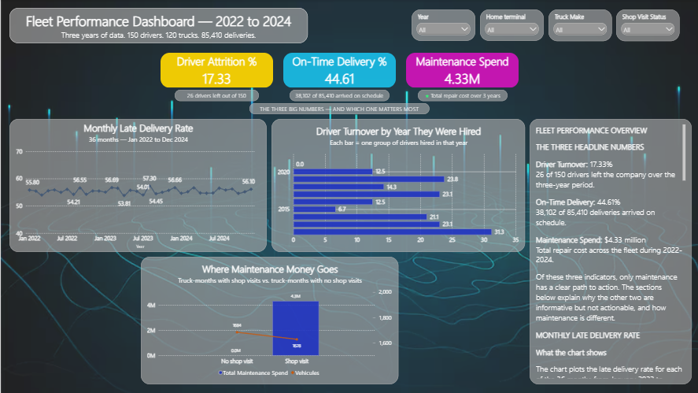
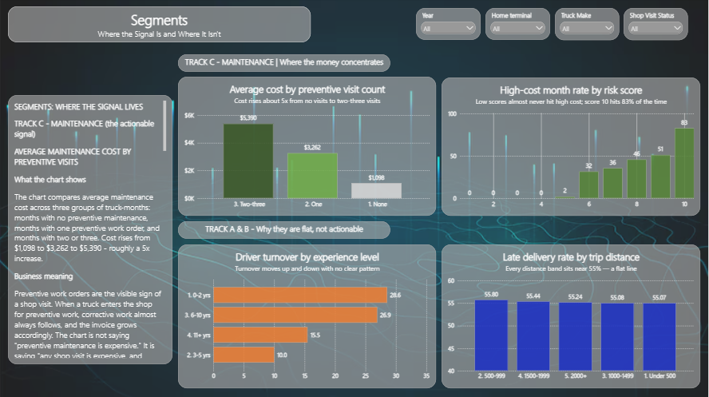

# Power BI Dashboard — Logistics Operations Database

> A 3-page interactive dashboard telling the story of three analytical tracks:
> two that are flat (attrition and delivery), and one highly actionable (maintenance).

---

## Overview

This folder contains the final three-page Power BI dashboard (`.pbix`), along with screenshots of each page and this documentation.

The dashboard is designed to be read from left to right, page by page. It translates the statistical findings from the SQL and Python pipelines into a visual decision tool for the Logistics Supervisor.

---

## Page-by-Page Breakdown

### Page 1 — Overview
*What is happening: headline numbers, flat patterns, discovery.*

**Key Visuals:**
- KPI cards showing total spend ($4.33M), total trips, and 26 leavers.
- Column charts showing the lack of pattern in driver turnover.
- A visual demonstrating the universally high late-delivery rate (54–57%).

### Page 2 — Segments
*Where the signal lives: Track C vivid vs Tracks A/B flat.*

**Key Visuals:**
- **Track C (Green):**
    - Average maintenance cost by preventive visit count (showing the 5x cost increase).
    - High-cost month rate by risk score (calibration chart showing the model works, hitting 83% at the top decile).
- **Track A & B (Gray/Orange):**
    - Driver turnover by experience level (bouncing up and down with no clear trend).
    - Late delivery rate by trip distance (a completely flat line around 55%).

### Page 3 — Action Plan
*What to do: three quantified recommendations.*

**Key Visuals:**
- Three recommendation text boxes (two green for savings, one red for a warning).
- **Chart 1:** Odds ratios showing that only preventive visits (12.5x) and downtime (1.08x) actually matter.
- **Chart 2:** Downtime ladder showing average cost rising steadily with more downtime hours.
- **Chart 3:** What-if simulation showing that blindly adding 10% more preventive visits raises predicted high-cost months from 828 to 923.

---

## Design Standards & UI

- **Language:** Plain English. No statistical jargon (e.g., no "p-value" or "odds ratio"; instead, "12 times more likely" or "no clear effect").

- **Colors:**
    - **Dark Green (`#375623`)**: Actionable, positive, maintenance savings.
    - **Dark Red (`#C00000`)**: Warning, cost increase (do not do this).
    - **Dark Blue (`#1F3864`)**: Page headers.
    - **Orange (`#ED7D31`)**: Track A (Attrition).
    - **Gray (`#A6A6A6`)**: Track B (On-Time Delivery).

- **Slicers:** 
    - There are four slicers in a 180px left sidebar (Year, Home Terminal, Truck Make, Shop Visits).
    - These are synced across all three pages. Changing a slicer on Page 1 updates Pages 2 and 3.

- **Text Boxes:** 
    - Each page features a single, consolidated text box at the bottom.
    - This acts as the "storyteller," explaining exactly what the charts show and what the business should do about it.

---

## Folder Structure

- **`Logistics Operations.pbix`** — The main Power BI report file.
- **`screenshots/`** — PNG images of all three dashboard pages for portfolio use.
- **`README.md`** — This document.

---

## Data Connections

The dashboard connects to the processed CSV files in the `data/processed/` folder:

- `master_driver_clean.csv`
- `master_trip_clean.csv`
- `master_truck_month_clean.csv`

In addition, Page 2 and Page 3 use three small tables created directly inside Power BI using the **"Enter Data"** feature:

- `calibration` (10 rows for the risk score chart)
- `odds_ratios` (7 rows for the model factor chart)
- `whatif` (2 rows for the simulation chart)

---

## How to Open and Refresh

1. Double-click **`Logistics Operations.pbix`** to open it in Power BI Desktop.
2. If the data paths have changed, go to **Home > Transform Data > Data Source Settings** and update the folder path to point to your local `data/processed/` folder.
3. Click **Refresh** on the Home ribbon to load the latest data.